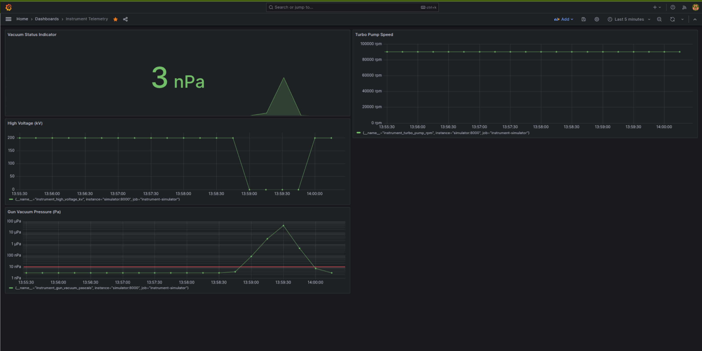

# Instrument Fleet Monitor

A simulator of an electron microscope vacuum system, monitored with Prometheus and Grafana. It reproduces a real protection mechanism: when the gun vacuum degrades, the high voltage is shut down automatically.



## How it works
- A Python simulator exposes gun vacuum pressure, high voltage and turbo pump speed as Prometheus metrics
- Normal mode: gun vacuum stays around 3e-9 Pa and the high voltage is 200 kV
- Leak mode: the pressure is multiplied by 1.25 on every update to simulate a vacuum leak
- Interlock: when the pressure rises above 1e-8 Pa, the high voltage drops from 200 kV to 0
- Back in normal mode, the system pumps down again and the high voltage recovers
- Grafana shows the vacuum on a log scale with the interlock threshold marked

## Tech stack
Python 3, Prometheus, Grafana, Docker, Docker Compose

## Quick start
```bash
git clone https://github.com/AlonPerry/instrument-fleet-monitor.git
cd instrument-fleet-monitor
docker compose up -d
```
- Grafana: http://localhost:3000 (dashboard: Instrument Telemetry)
- Prometheus: http://localhost:9090
- Simulator metrics: http://localhost:8000/metrics
- Toggle leak mode on and off: http://localhost:8000/toggle-leak

Stop the stack with `docker compose down`.

## Repository layout
- simulator/: Python telemetry simulator
- monitoring/: Prometheus and Grafana configuration
- docs/: quick commands and learning log
- docker-compose.yaml: the full stack

## Status and roadmap
Working: simulator, Prometheus scraping, Grafana dashboard, vacuum interlock.
Planned: alert rules, CI pipeline, Kubernetes deployment, and a latching interlock that requires a manual reset.
